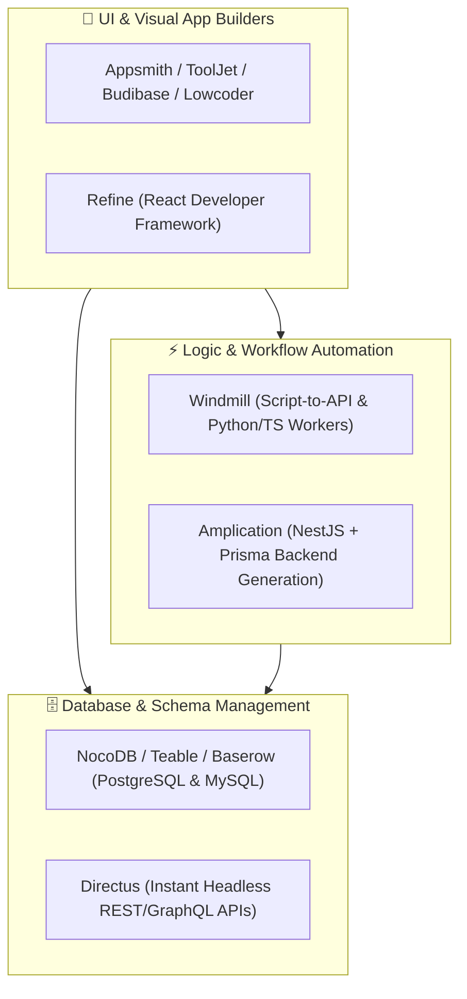

# 🚀 Awesome Low-Code Application Development (LCAP)

[-6366f1.svg)](https://github.com/ishandutta2007/Awesome-Low-Code-Application-Development-Lcap)

**Curated directory of enterprise SaaS platforms and self-hostable open-source GitHub frameworks for Low-Code Application Development (LCAP), Rapid Application Delivery (RAD), Citizen Development, and Internal Tool Builders.**

*Last updated: 2026*

---

## 📑 Table of Contents

- [🌐 Sector Overview & Market Dynamics](#-sector-overview--market-dynamics)
- [☁️ SaaS & Hosted Enterprise LCAP Platforms](#️-saas--hosted-enterprise-lcap-platforms)
- [⚡ Open-Source GitHub Projects & Self-Hosted LCAP Engines](#-open-source-github-projects--self-hosted-lcap-engines)
- [📦 Frameworks & Toolkits for Custom Low-Code Stacks](#-frameworks--toolkits-for-custom-low-code-stacks)
- [🤝 How to Contribute](#-how-to-contribute)
- [💖 Support](#-support)
- [⭐ Star History](#-star-history)
- [⚖️ Compliance & Governance Disclaimer](#️-compliance--governance-disclaimer)

---

## 🌐 Sector Overview & Market Dynamics

The global **Low-Code Application Development (LCAP)** and low-code development technologies market is estimated at **$28B–$33.7B in 2025–2026** (scaling past **$44B–$58B by 2028–2030** at an estimated 16%–19% CAGR, according to analyst consensus from Gartner and MarketsandMarkets). Over **70% of new enterprise applications** now leverage low-code or no-code abstractions to address developer shortages and accelerate digital transformation.

The sector exhibits **moderate fragmentation**: top-tier enterprise suites and cloud giants (Microsoft Power Apps, Salesforce, ServiceNow) dominate general enterprise workflow automation and core CRM extensions, while specialized high-performance platforms (OutSystems, Mendix, Appian) command heavy mission-critical workloads. In parallel, a vibrant, fast-growing tier of internal tool builders (Retool) and open-source, self-hosted alternatives (NocoDB, Appsmith, ToolJet, Refine, Budibase) serves data-sovereign engineering teams, preventing single-vendor lock-in.

---

## ☁️ SaaS & Hosted Enterprise LCAP Platforms

The following enterprise LCAP platforms are sorted in descending order by **company size / valuation / market capitalization** 💰.

| 🏢 Platform | 💰 Company Size (Valuation / Market Cap / Rev) | 💵 Starting Tier Pricing | 🎁 Free Tier Limit / Free Trial Limit | 🛠️ Core Capabilities & Primary Use Case |
| :--- | :--- | :--- | :--- | :--- |
| **[Microsoft Power Apps](https://powerapps.microsoft.com/)** | **~$3.1 Trillion** *(Market Cap)* | **$20/user/month** *(Power Apps Premium)* | **Permanently free Developer Plan** (1 user sandbox for learning/dev); **30-day free trial** with full premium feature access (extendable up to 90 days). | Deep integration with Microsoft 365, Dataverse, Azure, and 1,000+ connectors; enterprise governance and AI Copilot app authoring. |
| **[Salesforce Lightning Platform](https://www.salesforce.com/platform/)** | **~$280 Billion** *(Market Cap)* | **$25/user/month** *(Salesforce Platform Starter)* | **30-day free trial** (Salesforce Starter Suite with full access; no credit card required); permanent free developer edition via Trailhead Developer Orgs. | Visual declarative app builder, Lightning Web Components (LWC), Flow automation, and turnkey integration into Salesforce CRM and Data Cloud. |
| **[ServiceNow App Engine](https://www.servicenow.com/)** | **~$185 Billion** *(Market Cap)* | **~$75–$120/creator user/month** *(App Engine Foundation)* | **Permanently free Personal Developer Instance (PDI)** at developer.servicenow.com with full App Engine Studio access (auto-hibernates after 10 days of inactivity). | Low-code workflow and enterprise orchestration engine on the Now Platform; automates cross-departmental operations and ITSM/CSM extensions. |
| **[Mendix](https://www.mendix.com/)** *(Siemens)* | **~$140 Billion** *(Siemens Parent Market Cap)* | **€52.50/month base + ~€10.50/user/month** *(Basic tier; Standard starts at €918/month for single app)* | **Permanently free Free Edition** (up to ~6 concurrent users, deploys to Mendix Cloud sandbox, auto-sleeps after inactivity; no expiration). | Model-driven RAD platform supporting full-stack offline mobile, complex domain models, multi-cloud container deployments, and SAP integration. |
| **[Quickbase](https://www.quickbase.com/)** | **~$5.7 Billion** *(Acquisition Valuation)* | **$35/user/month** *(Team Plan, billed annually; min 20 users)* | **30-day free trial** (unlimited access to build apps, pipelines, dashboards, and integrations without credit card). | Relational no-code/low-code operational database builder; tailored for project tracking, field operations, and supply-chain logistics. |
| **[Retool](https://retool.com/)** | **~$3.2 Billion** *(Valuation)* | **$10/builder/month + $5/user/month** *(Team Plan, billed annually)* | **Permanently free Free Plan** for up to **5 total users**, unlimited apps, 500 workflow runs/month, and 5GB database/file storage. | Developer-first low-code UI builder with direct SQL/REST/GraphQL integrations, custom JavaScript, branching, and staging environments. |
| **[OutSystems](https://www.outsystems.com/)** | **~$3.0 Billion** *(Valuation)* | **$36,300/year base** *(ODC Starter tier, includes up to 100 internal users & 3 runtimes)* | **Permanently free Personal Edition** (ODC sandbox with 1 cloud environment for building personal apps; hibernates if inactive, reactivatable); **10-day enterprise trial**. | High-performance enterprise low-code engine generating compiled native code with automated CI/CD lifecycle management and zero-downtime rollouts. |
| **[Appian](https://appian.com/)** | **~$2.4 Billion** *(Market Cap)* | **~$75–$100/user/month** *(Standard tier entry estimate)* | **Permanently free Appian Community Edition** (dedicated sandbox site for exploration and hands-on developer training); customized cloud sales trials on request. | Enterprise process automation combining low-code application development with end-to-end BPM, RPA orchestration, and AI-driven case management. |
| **[Zoho Creator](https://www.zoho.com/creator/)** | **~$1.4 Billion+ ARR** *(Zoho Corporation Revenue)* | **$8/user/month** *(Standard Plan, billed annually)* | **Permanently free Free Plan** (1 user, 1 application, up to 5,000 records, 25MB storage); **15-day free trial** of premium features with no credit card required. | Drag-and-drop web and mobile business app builder using Deluge scripting, automated workflows, and turnkey integration into the Zoho ecosystem. |
| **[Caspio](https://www.caspio.com/)** | **~$100 Million+** *(Estimated Valuation / Bootstrap Scale)* | **$300/month** *(Team Plan; includes unlimited application users and creators)* | **14-day free trial** (includes all platform features, visual DataPages, relational database tools, and unlimited user creation; no credit card required). | Visual database-first application builder; suited for public portals, customer portals, directory management, and high-concurrency SaaS applications. |

---

## ⚡ Open-Source GitHub Projects & Self-Hosted LCAP Engines

The following open-source LCAP, rapid application development, and internal tool platforms are sorted in descending order by **GitHub Stars_Count** 🌟.

| 📦 Repository & Link | 🌟 GitHub_Stars_Badge | 💻 Tech Stack | 📖 Description & Capabilities |
| :--- | :---: | :--- | :--- |
| **[NocoDB](https://github.com/nocodb/nocodb)** |  | Node.js, Vue, TypeScript | Self-hosted smart spreadsheet and Airtable alternative that connects directly to MySQL, PostgreSQL, SQL Server, and SQLite. Exposes auto-generated REST and GraphQL APIs. |
| **[Twenty](https://github.com/twentyhq/twenty)** |  | TypeScript, React, NestJS, GraphQL | Open-source alternative to Salesforce and modular low-code CRM platform. Features extensible data models, kanban boards, workflows, and self-hosted control. |
| **[ToolJet](https://github.com/ToolJet/ToolJet)** |  | TypeScript, React, NestJS | Extensible low-code application builder for internal tools. Offers 50+ data connectors (PostgreSQL, MongoDB, Snowflake, REST APIs), drag-and-drop UI canvas, and ToolJet AI integration. |
| **[Appsmith](https://github.com/appsmithorg/appsmith)** |  | JavaScript, React, Java | Leading open-source framework for building internal apps, admin panels, and dashboards. Includes 45+ UI widgets, Git version control integration, custom JS write-ins, and multi-DB connectors. |
| **[Directus](https://github.com/directus/directus)** |  | TypeScript, Vue, Node.js | Instant low-code data platform and headless CMS that wraps any SQL database with real-time REST/GraphQL APIs, visual data modeling, roles/permissions, and automated flows. |
| **[Refine](https://github.com/refinedev/refine)** |  | TypeScript, React, Next.js, Vite | Developer-focused React framework for building internal tools, admin panels, B2B apps, and CRUD interfaces with decoupled UI and state management adapters. |
| **[Budibase](https://github.com/Budibase/budibase)** |  | JavaScript, Svelte, Node.js, CouchDB | Modern open-source low-code platform for building custom business applications, forms, automated workflows, and internal portals in minutes with Docker & Kubernetes support. |
| **[NocoBase](https://github.com/nocobase/nocobase)** |  | TypeScript, React, Node.js, Koa | Extensibility-first, plugin-driven low-code platform designed for bespoke enterprise systems, complex relational data structures, and granular permission architectures. |
| **[Teable](https://github.com/teableio/teable)** |  | TypeScript, React, PostgreSQL | Next-generation no-code spreadsheet and app platform built natively on PostgreSQL. Supports millions of rows without performance degradation, SQL formulas, and real-time collaboration. |
| **[Windmill](https://github.com/windmill-labs/windmill)** |  | Rust, TypeScript, Svelte | Developer platform that transforms scripts (Python, TypeScript, Go, Bash, SQL) into internal UIs, webhooks, and asynchronous workflows. Ultra-fast distributed workflow engine. |
| **[Amplication](https://github.com/amplication/amplication)** |  | TypeScript, Node.js, NestJS, Prisma | Developer-centric backend generation engine. Visually model data structures, roles, and business logic to generate clean, human-readable NestJS backends with GraphQL/REST APIs. |
| **[ILLA Builder](https://github.com/illacloud/illa-builder)** |  | TypeScript, React, Go | Robust low-code tool that empowers developers to build internal tools and enterprise applications rapidly with drag-and-drop components, database queries, and AI integrations. |
| **[Grist Core](https://github.com/gristlabs/grist-core)** |  | Python, TypeScript, SQLite | Modern relational spreadsheet and database platform. Features full Python formula support, granular access control lists (ACL), custom layout builder, and data-driven charts. |
| **[Rowy](https://github.com/buildship-ai/rowy)** |  | TypeScript, React, Firebase/GCP | Open-source low-code platform for Firebase and Google Cloud. Manage your database with an intuitive spreadsheet GUI and write cloud functions right inside your browser. |
| **[Baserow](https://github.com/baserow/baserow)** |  | Python, Django, Vue.js, PostgreSQL | Modular open-source no-code database and application builder. Create collaborative databases with customized views, webhooks, and developer-friendly REST APIs. |
| **[Lowdefy](https://github.com/lowdefy/lowdefy)** |  | JavaScript, React, Node.js | Declarative config-driven web application stack. Build enterprise CRUD apps, ticketing tools, and admin dashboards using YAML or JSON schema configurations with Git versioning. |
| **[DashPress](https://github.com/dashpresshq/dashpress)** |  | JavaScript, Node.js | Auto-generates responsive admin applications and management portals by inspecting existing database schemas without writing a line of custom code. |
| **[Lowcoder](https://github.com/lowcoder-org/lowcoder)** |  | TypeScript, React, Java, Spring | Open-source low-code IDE with 120+ pre-built components, freeform layout design, iFrame-less web embedding, real-time query libraries, and full self-hosting. |
| **[Jmix Framework](https://github.com/jmix-framework/jmix)** |  | Java, Spring Boot, Vaadin | Full-stack rapid application development framework for Java and Spring Boot. Accelerates enterprise data-driven business applications with visual designer tools and security models. |
| **[Joget DX](https://github.com/jogetworkflow/jw-community)** |  | Java, Spring, Hibernate | Open-source low-code application and workflow automation platform converging process modeling, citizen app building, and enterprise integration plugins. |
| **[REI3](https://github.com/r3-team/r3)** |  | Go, Vue.js, PostgreSQL | Lightweight, self-hosted low-code business software engine. Build modular multi-user applications with zero license costs and an integrated community app repository. |
| **[Convertigo](https://github.com/convertigo/convertigo)** |  | Java, Angular, Apache Cordova | Full-stack low-code enterprise platform for cross-platform web and mobile applications with FullSync offline data synchronization, enterprise connectors, and MCP agent support. |

---

## 📦 Frameworks & Toolkits for Custom Low-Code Stacks

Looking to assemble a complete, proprietary-free enterprise app development pipeline? Consider this layered modular architecture:

- **Visual Internal Tools**: Combine **[Appsmith](https://github.com/appsmithorg/appsmith)** or **[ToolJet](https://github.com/ToolJet/ToolJet)** for responsive admin dashboards and executive portals.
- **Relational Data & Views**: Use **[Teable](https://github.com/teableio/teable)** or **[NocoDB](https://github.com/nocodb/nocodb)** for spreadsheet-grade multi-table relational applications.
- **Microservices & Async Workflows**: Leverage **[Windmill](https://github.com/windmill-labs/windmill)** to turn Python/TypeScript/Bash scripts into reliable, scheduled internal webhooks and microservices.
- **Enterprise Code Generation**: Use **[Amplication](https://github.com/amplication/amplication)** to auto-generate production-grade, audited Node.js/NestJS codebases for full developer sovereignty.

---

## 🤝 How to Contribute

We welcome contributions from citizen developers, software architects, and open-source maintainers! 🌟

1. **Fork** this repository.
2. Create a new descriptive branch (`git checkout -b add-my-lcap-tool`).
3. Add your SaaS or Open-Source tool to the appropriate table.
   - For SaaS tools: Include platform name, company size/valuation, specific pricing tier, specific free tier/trial limit, and key capabilities.
   - For Open-Source tools: Include GitHub repository name, live Stars_Badge linked to stargazers, primary tech stack, and clear architectural description.
4. Open a **Pull Request** detailing why the tool belongs in this curated LCAP list.

---

## 💖 Support

Thank you for exploring this curated repository! If you find this resource valuable for your research, enterprise architecture design, or low-code stack evaluation, please consider showing your support:

- ⭐ **Star** this repository to help others discover it.
- 🍴 **Fork** and contribute tools, corrections, or updates.
- 📢 **Share** it with your fellow developers, engineers, and low-code communities.
- ☕ **Buy me a coffee / Sponsor**: If you appreciate this work and want to support ongoing maintenance and new curated resources, you can sponsor the project via the [GitHub Sponsor Dashboard](https://github.com/sponsors/ishandutta2007).

---

##  Star History

---

## ⚖️ Compliance & Governance Disclaimer

- This curated list is maintained for educational and architectural evaluation purposes; inclusion does not constitute a formal commercial endorsement.
- Enterprise low-code deployments must implement proper role-based access control (RBAC), row-level security (RLS), and comply with relevant regulatory frameworks (**GDPR**, **HIPAA**, **SOC 2 Type II**, **ISO 27001**).
- When deploying self-hosted open-source software, ensure database isolation, automated backup strategies, and vulnerability patching routines are maintained.

---

**Built with ❤️ for citizen developers, enterprise IT architects, and developers building the future of software.**

[⬆ Back to Top](#-awesome-low-code-application-development-lcap)

